<a href="https://berseni.id"><picture><source media="(prefers-color-scheme: dark)" srcset="docs/readme/banner-dark.svg"></picture></a>

<p align="center"><a href="https://berseni.id"><b>Open berseni.id</b></a> · <a href="#getting-started">Getting started</a> · <a href="https://github.com/nugrahalabib">More of my work</a> · <a href="https://nugrahalabib.com">nugrahalabib.com</a></p>

## Overview

Berseni is an Indonesian art community. It runs offline painting workshops, sells online classes taught by Indonesian artists, and offers original artworks. Berseni.id is its public website and the admin panel behind it, live at berseni.id since June 2026.

The Berseni team is not technical, and its offer changes every few weeks: a new workshop poster, a new class, a new artwork, a new podcast article. Every page, product, post, gallery photo and search setting is edited at /admin, with the Indonesian and English text side by side, and no code is touched.

Sales stay where the team already sells. Each product links to its Shopee or lynk.id page, and a floating WhatsApp button opens a chat with the team, so the site explains and sends people on rather than taking payments.

<picture><source media="(prefers-color-scheme: dark)" srcset="docs/readme/features-dark.svg"></picture>

## Why it exists

Berseni.id is the website of Berseni, an Indonesian art community that runs painting workshops, sells online classes with Indonesian artists, and offers original artworks. Nugraha Labib Mujaddid built it under AgentBuff as client work, and it has been live at berseni.id since June 2026. The Berseni team edits all of it themselves from an admin panel, in Indonesian and English. The site explains the offer and sends people on to the Shopee or lynk.id page of each product, or to a WhatsApp chat with the team.

A community like Berseni changes its offer every few weeks: a workshop with a new theme and venue, an online class with a new artist, a new painting, a new podcast episode written up as an article. Each change needs new text, a poster or photo, and a price.

Berseni already sells through a lynk.id store page and Shopee, and talks to customers on WhatsApp and social media. What it lacked was its own bilingual home that explains who it is, shows every program in one place, ranks in search, and that the team can update without asking a developer each time.

| Who | What they do with it |
| --- | --- |
| **Visitor or learner** | Reads about Berseni, browses workshops, online classes and artworks in Indonesian or English, then follows a product link or opens a WhatsApp chat. |
| **Collector** | Browses the artwork catalogue with promo and original prices and opens the marketplace page of a painting. |
| **Brand or venue partner** | Reads the collaboration page and contacts the team about a co-branded workshop or a venue partnership. |
| **Berseni team** | Signs in at /admin and edits page sections, the catalogue, blog posts, gallery photos, SEO fields and the Meta Pixel, then exports a JSON backup. |

<picture><source media="(prefers-color-scheme: dark)" srcset="docs/readme/before-after-dark.svg"></picture>

<picture><source media="(prefers-color-scheme: dark)" srcset="docs/readme/journey-dark.svg"></picture>

<picture><source media="(prefers-color-scheme: dark)" srcset="docs/readme/value-dark.svg"></picture>

## Tour

### 1. Home page

The home page introduces Berseni with an illustrated hero, the partners that host its workshops, the three programs, and a carousel of everything on sale. Each block is a section the team can edit or hide from the admin panel.

- Hero text, buttons and illustration layers set from the admin
- Partner logo strip and a three-pillar program block
- Collection carousel filtered by artworks, offline workshops and online classes

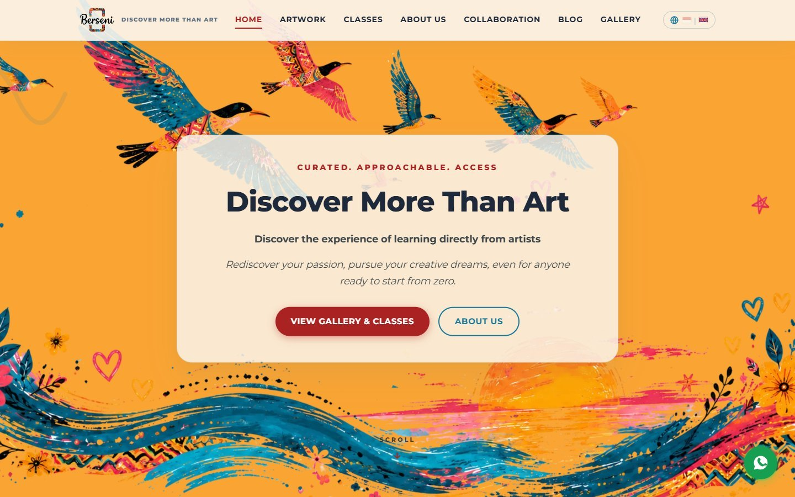

<sub>Home hero on the live site, in English.</sub>

<p>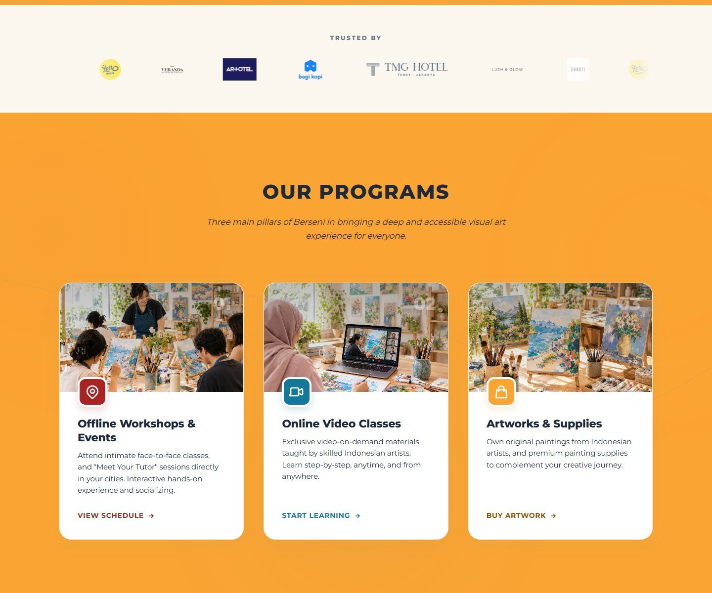 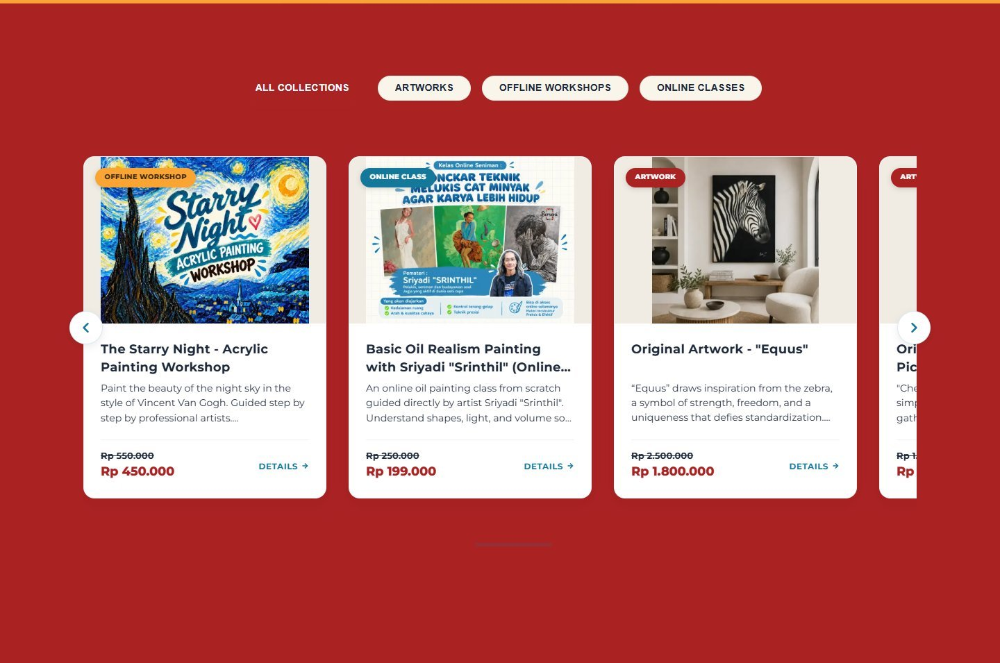</p>

<sub>Left: Partner logos and the three programs: workshops, online classes, artworks and supplies. · Right: Collection carousel with category filters, promo prices and detail links.</sub>

### 2. Classes and artworks

Two catalogue pages read from the same product list. Classes shows offline workshops and online classes; Artwork shows original paintings. Both have search and sorting, and every card leads to a detail view with the marketplace link.

- Search box, category pills and a sort menu
- Promo price with the original price struck through
- Category badge on every card

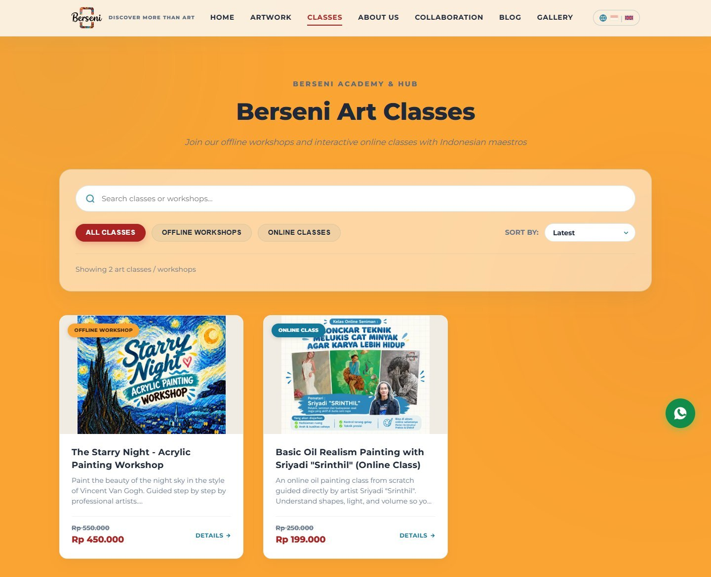

<sub>Classes page with an offline workshop and an online class.</sub>

<p>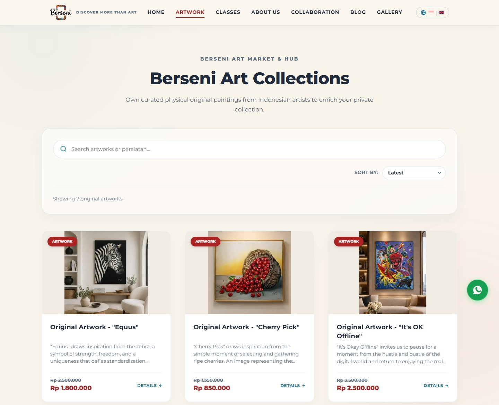</p>

<sub>Artwork page with original paintings and their prices.</sub>

### 3. Story, articles and partnerships

The About page tells why Berseni exists, the blog publishes artist conversations and art notes, and the collaboration page invites brands and venues to host workshops. All three are bilingual and editable.

- Long form About text with highlight cards
- Featured article plus a grid of the latest posts, each with its own slug
- Brand and venue collaboration sections with WhatsApp calls to action

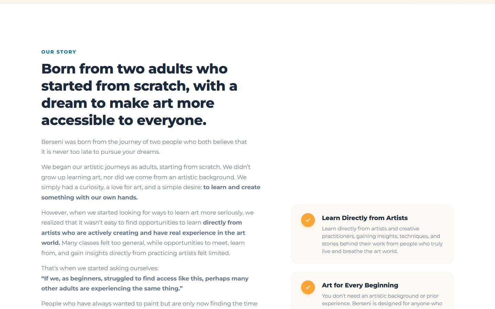

<sub>About page: the story of how Berseni started.</sub>

<p>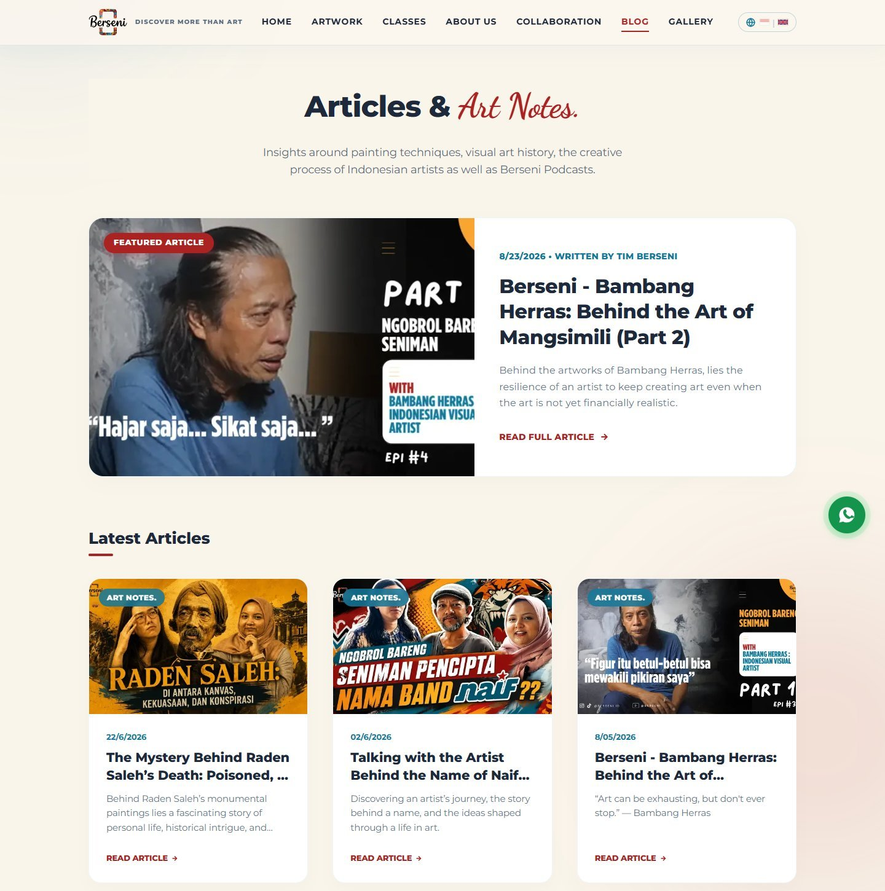 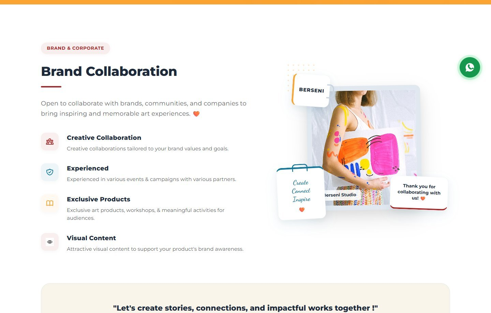</p>

<sub>Left: Articles and Art Notes: a featured artist conversation and the latest posts. · Right: Collaboration page for brands and corporate partners.</sub>

### 4. On a phone

On a phone the navigation collapses into a menu, the hero card stacks, and the WhatsApp button stays in reach. Recent commits fixed details that only showed up on iPhone and Safari.

- Logo tagline kept on phones where there is room
- Fixes for testimonials and partner logos on iPhone and Safari (commit history)

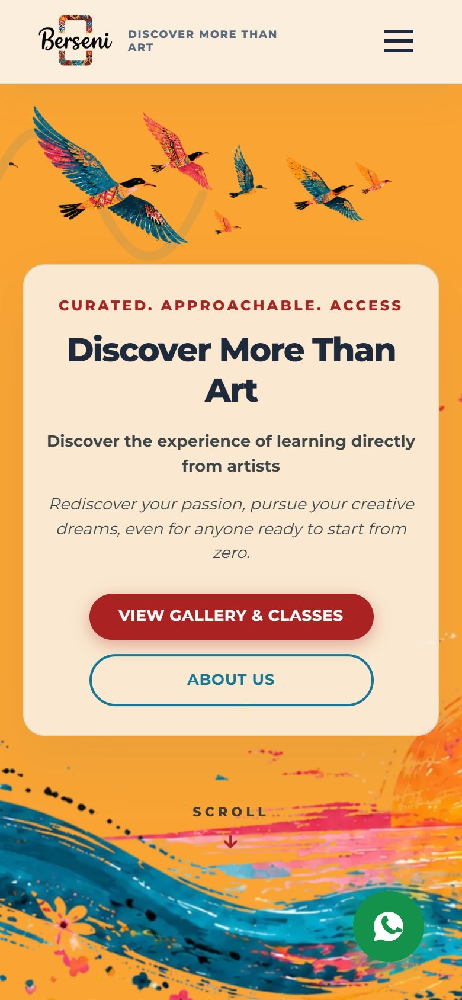

<sub>Home page at 390 by 844 on the live site.</sub>

### 5. Admin sign-in and overview

The team signs in with one password at /admin/login. The overview counts catalogue items and articles, shows the languages in use, and offers shortcuts to edit content, tune SEO and export a backup.

- One active session: a new login signs out every other device
- Shortcut to download content, catalogue, posts and SEO settings as one JSON file
- Admin interface in Indonesian, the team's working language

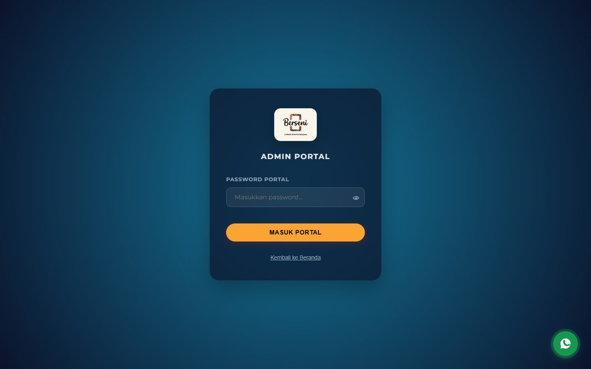

<sub>Admin sign-in (local run).</sub>

<p>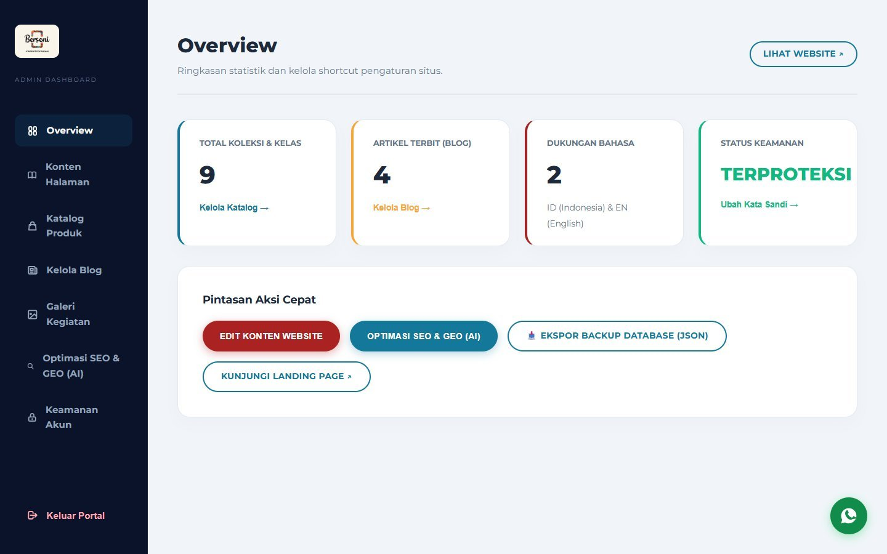</p>

<sub>Admin overview with counts and quick actions (local run, seed content).</sub>

### 6. Page content editor

Every public page is split into sections: navbar, hero, programs, collections, promo banner, testimonials, WhatsApp call to action, activity carousel, partner logos and footer. The team picks a page, then a section, and edits Indonesian and English side by side.

- Bold and italic shortcuts and paragraph breaks in long text
- Footer credit, social links and the WhatsApp number in one place
- Unsaved changes are guarded when switching tabs

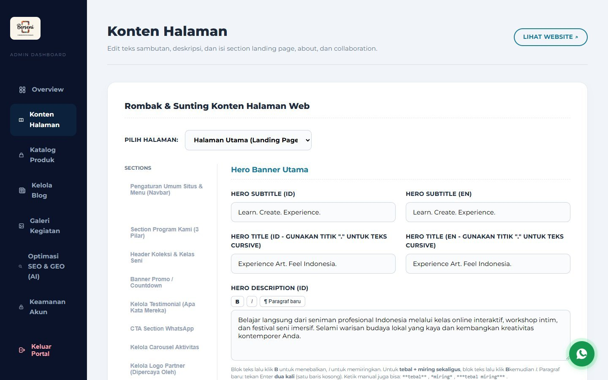

<sub>Editing the home hero in both languages (local run, seed content).</sub>

### 7. Catalogue, blog and gallery

Artworks, offline workshops and online classes are added in one bilingual form with a category, promo and original price, a Shopee or lynk.id link and an image. Articles and gallery photos follow the same pattern.

- Three product categories in one list
- Name, category and marketplace link are required by the API
- Images upload to Vercel Blob in production

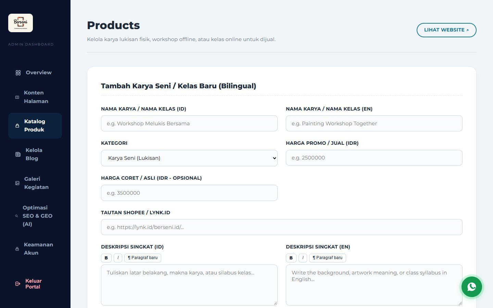

<sub>Adding an artwork or class to the catalogue (local run).</sub>

### 8. SEO, GEO and Meta Pixel

Each page has its own title, description and keywords in both languages, plus a geographic tag and fields that state brand facts for AI search assistants. The Meta Pixel can be switched on and its ID set from the same screen.

- Per page metadata for home, about, collaboration, store, classes and blog
- Dynamic sitemap.xml and robots rules
- JSON-LD structured data rendered on the server

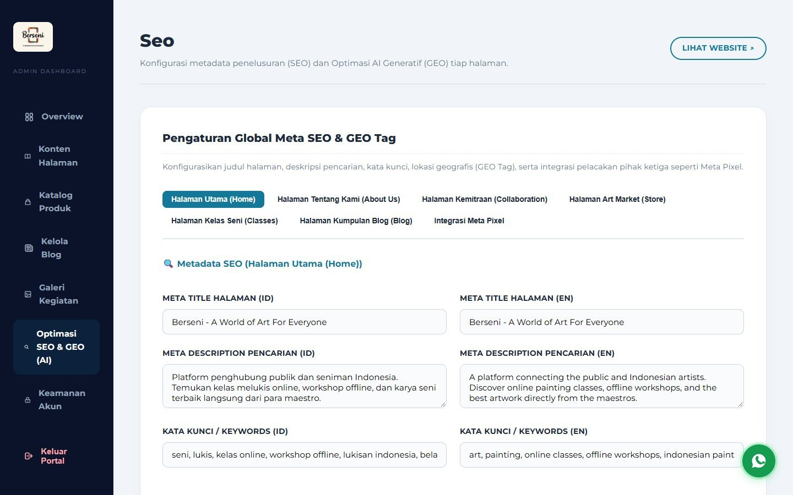

<sub>SEO and GEO settings for the home page (local run, seed content).</sub>

### 9. Account security

The team changes the admin password here. The old password is required, the new one must have at least 8 characters, and it is stored as a bcrypt hash.

- Old password required to set a new one
- Minimum length enforced on the server

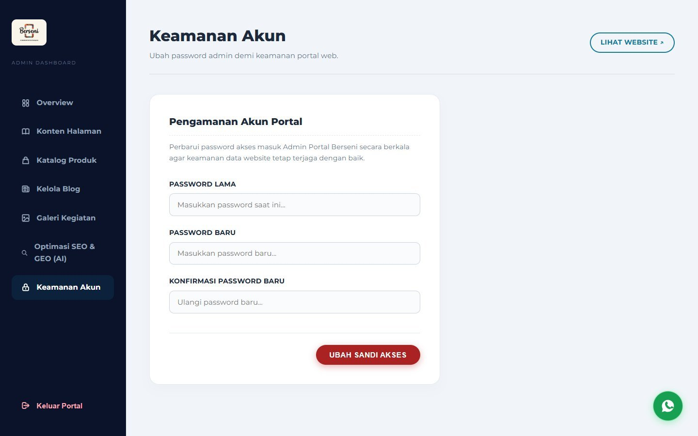

<sub>Change password screen (local run).</sub>

## How it is built

A single Next.js 16 App Router project in JavaScript. Each public route is a small server component that loads data and hands it to a client component (for example LandingPageClient.js), which handles the language toggle, carousels and modals. The admin panel at /admin is one client dashboard with an editor component per area.

All reads and writes go through src/lib/db.js. When KV_REST_API_URL and KV_REST_API_TOKEN are set it uses Vercel KV with keys prefixed berseni:; otherwise it uses data/db.json, created from seed content on first run and kept out of git. Images go to Vercel Blob when BLOB_READ_WRITE_TOKEN is set, and to the local disk otherwise.

Every write route checks the signed session cookie and compares its session id with the single active id stored in the database.

<picture><source media="(prefers-color-scheme: dark)" srcset="docs/readme/architecture-dark.svg">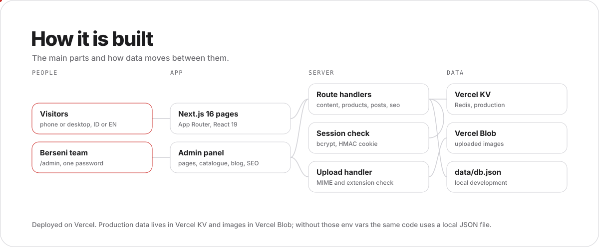</picture>

<picture><source media="(prefers-color-scheme: dark)" srcset="docs/readme/data-model-dark.svg"></picture>

<picture><source media="(prefers-color-scheme: dark)" srcset="docs/readme/flow-1-dark.svg"></picture>

<picture><source media="(prefers-color-scheme: dark)" srcset="docs/readme/flow-2-dark.svg"></picture>

<picture><source media="(prefers-color-scheme: dark)" srcset="docs/readme/flow-3-dark.svg"></picture>

### Security

- Passwords are stored as bcrypt hashes with cost 12; a legacy plaintext value is upgraded to a hash on the next successful login.
- Session cookies are HMAC SHA-256 signed, httpOnly, sameSite strict, secure in production, and expire after 24 hours.
- Only one session can write at a time, and logging out rotates the active session id on the server.
- Login is limited to 8 attempts per 15 minutes per IP (in memory, per instance).
- Uploads allow only JPG, PNG, WebP, GIF and AVIF up to 5 MB, checked by MIME type and by extension.
- The local datastore lives in data/, outside public/, and is ignored by git.

### Decisions

| Decision | Why |
| --- | --- |
| Key value store instead of a database | The whole site is a handful of documents (content, products, posts, gallery, SEO). Vercel KV stores each as one key, with no schema or migrations to maintain. |
| JSON file fallback | The same code runs on a laptop without any cloud account, which makes local work and handover simple. |
| Link out for payments | Berseni already sells on Shopee and lynk.id and answers on WhatsApp, so the site sends buyers there instead of adding a checkout. |
| Bilingual fields, not translation files | The team writes both versions itself in the admin, so every text is stored as an _id and _en pair next to each other. |
| Single active session | A small team shares one admin password; signing out older devices on every login limits the damage of a forgotten browser. |

<picture><source media="(prefers-color-scheme: dark)" srcset="docs/readme/stack-dark.svg">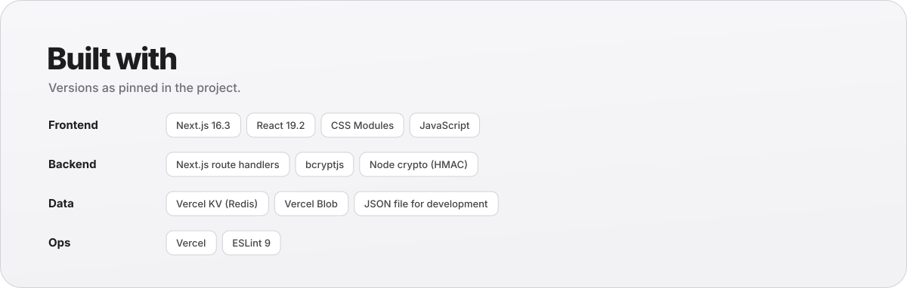</picture>

### Highlights

- One data adapter picks Vercel KV when its env vars are set and a local JSON file otherwise, so the site runs on a laptop with no accounts or keys.
- Old plaintext passwords are checked once and re-saved as bcrypt hashes on the next successful login.
- A new login replaces the single active session id, and logging out rotates it on the server, so an old cookie stops working at once.
- Uploads are checked by MIME type and by file extension, so a renamed SVG cannot be stored and served as an image.
- On Vercel production the app refuses to start without SESSION_SECRET instead of signing cookies with a default key.

## Getting started

The site runs on a laptop with no cloud account: without Vercel KV and Vercel Blob settings it stores
data in a local JSON file and uploads in `public/uploads/`.

### Requirements

- Node.js 20.9 or newer (Next.js 16 requirement) and npm

### Run it locally

```bash
git clone https://github.com/nugrahalabib/Website-Berseni.id.git
cd Website-Berseni.id
npm install
```

Create `.env.local` in the project root:

```env
ADMIN_PASSWORD=choose-a-long-password
SESSION_SECRET=a-long-random-string
```

```bash
npm run dev
```

Open http://localhost:3000 for the site and http://localhost:3000/admin/login for the admin panel.

On the first request the app creates `data/db.json` from built-in seed content. `ADMIN_PASSWORD`
becomes the first admin password and is saved as a bcrypt hash on the first successful login. Change
it later under **Keamanan Akun** (account security) in the admin panel. `data/` is ignored by git.

### Environment variables

| Name | Needed for | Notes |
| --- | --- | --- |
| `ADMIN_PASSWORD` | first sign-in | Set it before the first run. |
| `SESSION_SECRET` | signing the admin cookie | Required on Vercel production: the app will not start there without it. |
| `KV_REST_API_URL`, `KV_REST_API_TOKEN` | production data | When both are set, data is read from and written to Vercel KV. Leave empty locally. |
| `BLOB_READ_WRITE_TOKEN` | production uploads | When set, admin uploads go to Vercel Blob; otherwise to `public/uploads/`. |
| `NEXT_PUBLIC_SITE_URL` | canonical links, sitemap, JSON-LD | Defaults to `https://berseni.id`. |

`VERCEL_ENV` and `NODE_ENV` are set by the platform.

### Scripts

| Command | What it does |
| --- | --- |
| `npm run dev` | Development server on port 3000 |
| `npm run build` | Production build |
| `npm run start` | Serve the production build |
| `npm run lint` | ESLint |

There are no automated tests yet.

### Deploying

The live site runs on Vercel. Connect a KV store and a Blob store to the project, then set
`ADMIN_PASSWORD`, `SESSION_SECRET` and `NEXT_PUBLIC_SITE_URL`. On the first request the app seeds the
store with the default content. Note: npm marks `@vercel/kv` as deprecated and points new projects to a
Redis integration from the Vercel Marketplace.

### What was run for this page

On 26 Nov 2026 the repository was copied to a temporary folder and run with `npm ci` and
`next dev` on a local port, with a locally generated `ADMIN_PASSWORD` and `SESSION_SECRET` and no KV
or Blob settings. The admin screenshots come from that run, using the built-in seed content. The
public page screenshots were taken from the live site, berseni.id.

### Corrections to the earlier README

- The local datastore is `data/db.json`, outside `public/`, not `public/db.json`.
- `SESSION_SECRET` and `BLOB_READ_WRITE_TOKEN` were missing from the setup.
- The project uses Next.js 16.3.5, not 16.2.

### Project structure

```text
src/
  app/                 public pages (home, about, classes, store, gallery, blog, collaboration),
                       admin pages, sitemap.js, robots.js
  app/api/             route handlers: auth, content, products, posts, gallery, seo, upload, backup
  components/          page client components, Navbar, Footer, JsonLd, MetaPixelTracker, FloatingWhatsApp
  components/Admin/    dashboard and editors: page content, products, blog, gallery, SEO, account
  lib/                 db.js (KV or JSON file), auth.js (bcrypt, HMAC sessions), whatsapp.js, imageUpload.js
  styles/              CSS modules
public/                logo, hero illustration layers, partner logos, workshop posters
```

### License

All rights reserved. See [LICENSE](LICENSE). This is client work for Berseni; the code and all images, logos and posters are not
licensed for reuse.

---

<sub>Made by [Nugraha Labib Mujaddid](https://github.com/nugrahalabib) · [nugrahalabib.com](https://nugrahalabib.com) · [nugrahalabib@gmail.com](mailto:nugrahalabib@gmail.com)</sub>
